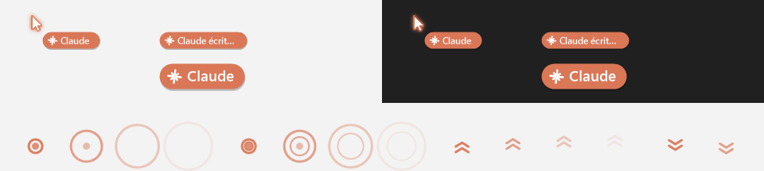
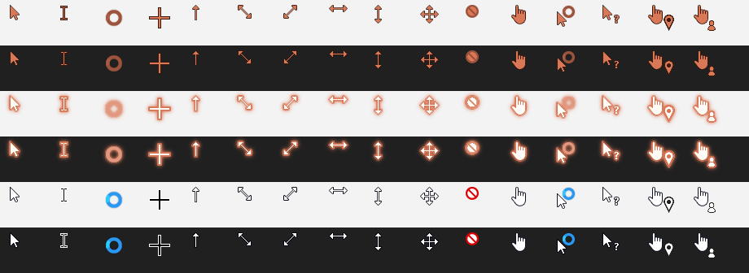
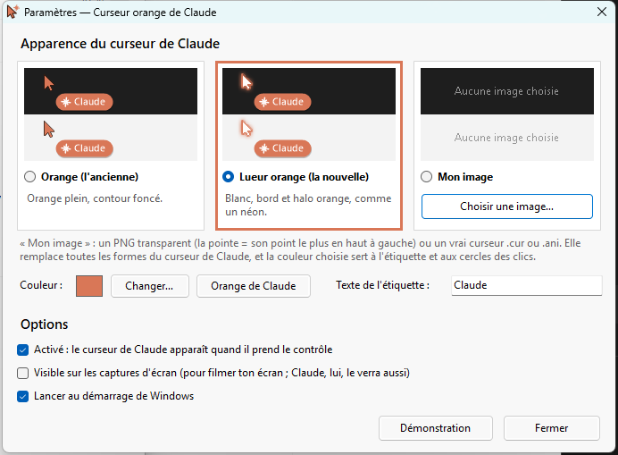

# Curseur orange de Claude

Quand Claude prend le contrôle de ton ordinateur (l'outil « computer use » de l'appli Claude pour Windows), il a **son propre curseur orange**, et **le tien reste là où tu l'as laissé**.



> Projet personnel et non officiel, sans lien avec Anthropic.

## Ce que ça fait

- Quand Claude bouge la souris, le vrai curseur devient **orange** avec une étiquette **« ✳ Claude »** : c'est le sien.
- **Ton curseur à toi reste dessiné** à l'endroit où tu l'avais laissé.
- Dès que tu bouges ta souris, **tu la récupères à cet endroit**. Le curseur orange de Claude reste affiché là où il travaillait, puis s'efface quand Claude a fini.
- Chaque clic de Claude fait une **onde orange**. Quand il tape au clavier, l'étiquette devient **« Claude écrit… »**.
- Pendant un clic ou un glisser-déposer de Claude, ta souris attend **moins d'une seconde** (seul ton curseur dessiné bouge), pour que son clic ne parte pas au mauvais endroit.
- **Trois apparences au choix** : la **lueur orange** (blanc, bord et halo orange, comme un néon), l'**orange plein**, ou **ta propre image**.

Tous les curseurs de Windows ont leur version Claude : flèche, main, barre de texte, redimensionnement, sablier…



## Changer l'apparence

Double-clique sur la flèche orange près de l'horloge (ou relance l'appli) : la fenêtre **Paramètres** s'ouvre.



- **Lueur orange (la nouvelle)** : blanc, bord et halo orange. C'est le choix de départ.
- **Orange (l'ancienne)** : orange plein, contour foncé.
- **Mon image** : clique sur **Choisir une image…**. Un PNG transparent convient (sa pointe est son point le plus en haut à gauche, et il est réduit à la taille d'un curseur), un vrai curseur `.cur` ou `.ani` aussi. L'image est copiée dans le dossier de l'appli, tu peux donc déplacer l'original.
- Tu peux aussi changer la **couleur** (étiquette, bord, halo, cercles des clics) et le **texte de l'étiquette**.

Chaque changement s'applique tout de suite, même pendant que Claude a la main.

## Installer

1. Télécharge `CurseurClaude.exe` dans les [Releases](../../releases) et mets-le dans un dossier à toi.
2. Double-clique dessus. Windows peut afficher « Windows a protégé votre ordinateur » (l'exe n'est pas signé) : clique sur **Informations complémentaires**, puis sur **Exécuter quand même**.
3. Une **flèche orange** apparaît près de l'horloge (parfois cachée derrière la petite flèche **^**). Double-clique dessus pour ouvrir les **Paramètres**, qui ont un bouton **Démonstration**.

L'appli se lance toute seule au démarrage de Windows. Tu peux changer ça dans son menu.

## Le menu (clic droit sur la flèche orange)

| Choix | Effet |
|---|---|
| **Paramètres…** | Ouvre la fenêtre Paramètres (comme le double-clic sur l'icône). |
| **Apparence du curseur** | Change vite de style : lueur orange, orange, ou ton image. |
| **Activé** | Met l'appli en pause, ou la relance. |
| **Faire une démonstration** | Le curseur orange fait un petit tour. Bouge ta souris pour l'arrêter. |
| **Comment ça marche ?** | Un petit rappel. |
| **Visible sur les captures d'écran** | Coche-le pour **filmer** ton écran avec le curseur orange. Décoché, il est invisible sur les captures, donc Claude ne le voit pas. |
| **Lancer au démarrage de Windows** | Démarrage automatique. |
| **Quitter** | Ferme l'appli et remet les curseurs normaux. |

## Important : autoriser l'appli quand Claude prend le contrôle

L'outil de contrôle de Claude masque en **rectangle noir**, sur ses captures, les fenêtres des programmes qu'on ne lui a pas autorisés. Le curseur orange est fait de petites fenêtres transparentes, donc Claude verrait des rectangles noirs à côté de son curseur.

**Solution :** quand Claude demande l'accès aux applications, ajoute **`curseurclaude.exe`** (ou dis-lui de l'ajouter). Les rectangles noirs disparaissent, et le curseur orange reste invisible pour Claude tout en restant visible pour toi.

## Comment ça marche (technique)

- L'outil de contrôle de l'appli Claude (module `@ant/claude-native`, bibliothèque Rust *enigo*) bouge la souris avec `SendInput` et signe chaque événement d'un `dwExtraInfo` égal à **100**. Ta vraie souris, elle, a la signature 0.
- L'appli pose des **crochets bas niveau** (`WH_MOUSE_LL`, `WH_KEYBOARD_LL`) dans un fil à elle. Elle ne bloque jamais les événements de Claude, et ne touche jamais au clavier.
- Au premier geste de Claude, elle dessine une copie de ton curseur à ta place (fenêtre `WS_EX_LAYERED | WS_EX_TRANSPARENT`, traversée par les clics), et remplace les curseurs de Windows par des copies orange (`SetSystemCursor`).
- Quand tu bouges ta souris, elle remet ton curseur à ta place (`SetCursorPos`, invisible pour les crochets) et remet les vrais curseurs. Si tu cliques alors que le curseur était chez Claude, ton clic est refait chez toi.
- Un clic déjà envoyé part là où était la souris au moment de l'envoi. L'appli ne te rend donc jamais la souris en plein geste de Claude (0,9 s de grâce, 10 s au plus s'il tient un bouton).
- Les calques sont exclus des captures (`WDA_EXCLUDEFROMCAPTURE`). Un petit processus **gardien** remet les curseurs normaux même si l'appli plante.

## Réglages

Ils sont dans `%LOCALAPPDATA%\CurseurClaude\reglages.txt` : style (`orange`, `lueur` ou `perso`), image perso, sa taille maximale (`taille=32`) et la position de sa pointe (`pointe=x,y`, vide = automatique), couleur, contour, texte de l'étiquette, durée d'affichage, signature des gestes de Claude (`marques=100`), journal détaillé. Si une mise à jour de l'appli Claude change la signature, il suffit de modifier `marques`.

Commandes utiles : `CurseurClaude.exe --parametres`, `--demo`, `--quitter`, `--etat` (écrit `etat.txt`), `--recharger` (relit les réglages), `--planche image.png` (dessine tous les curseurs dans une image).

## Compiler soi-même

Aucun outil à installer : le compilateur C# fourni avec Windows suffit.

```powershell
.\construire.ps1            # compile CurseurClaude.exe
.\construire.ps1 -Relancer  # compile, remplace l'appli qui tourne et la relance
```

## Limites

- Windows n'a qu'un seul vrai curseur. Pendant un geste de Claude (moins d'une seconde), ta souris ne fait bouger que ton curseur dessiné.
- Si l'appli Claude agit sans bouger la souris (mode « applications en arrière-plan »), il n'y a rien à montrer.
- La signature 100 vient de l'appli Claude de novembre 2026 et pourrait changer.

## Licence

MIT — voir [LICENSE](LICENSE).
